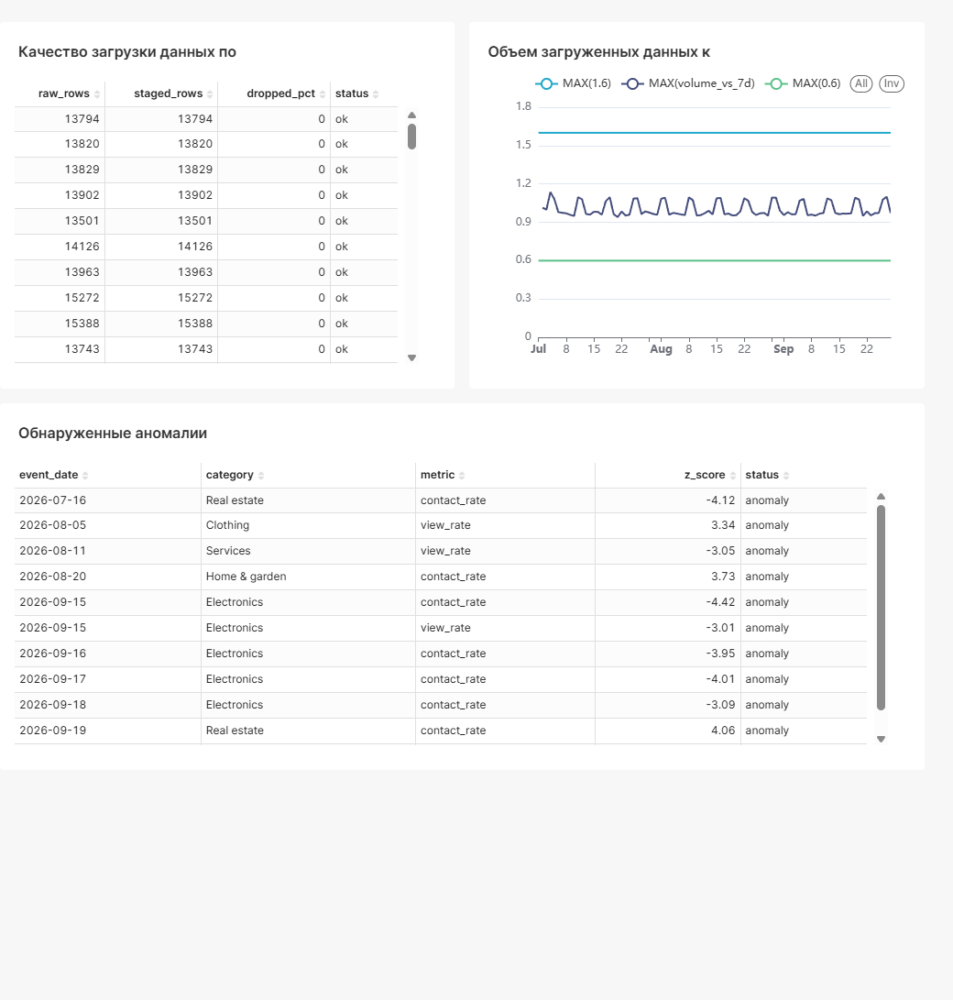
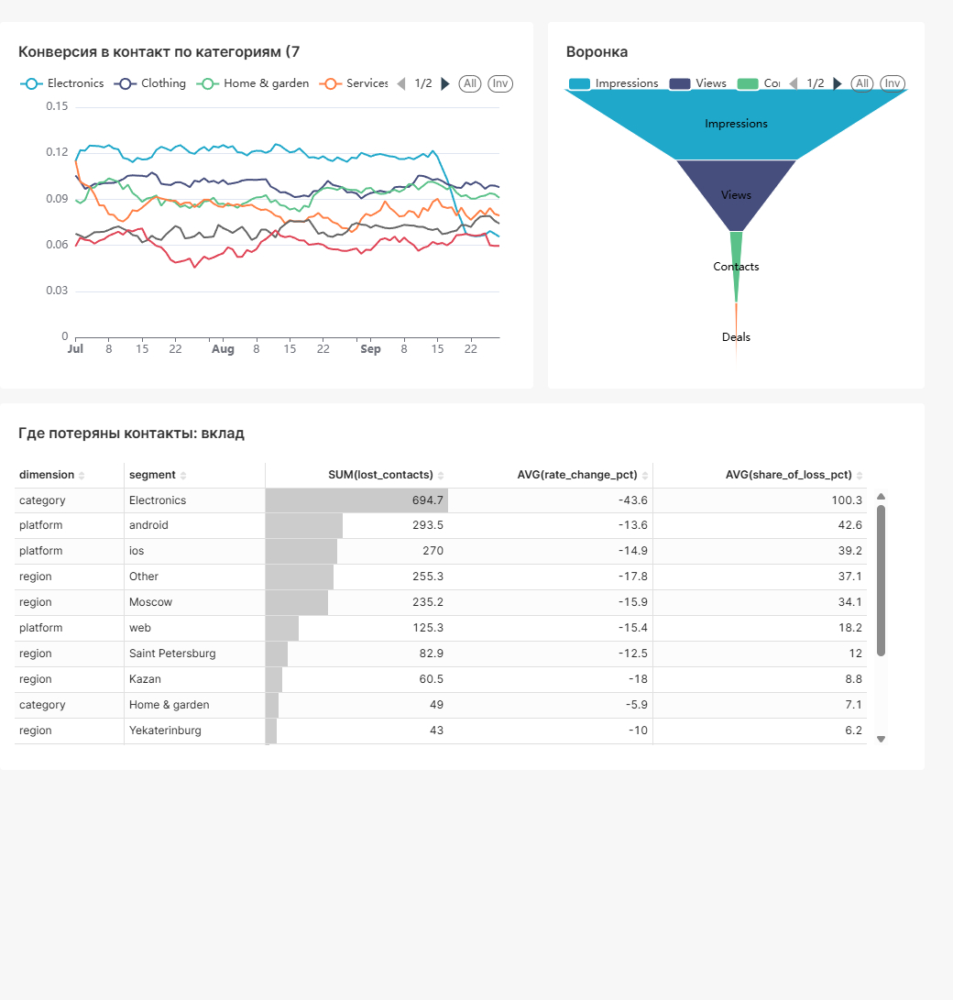
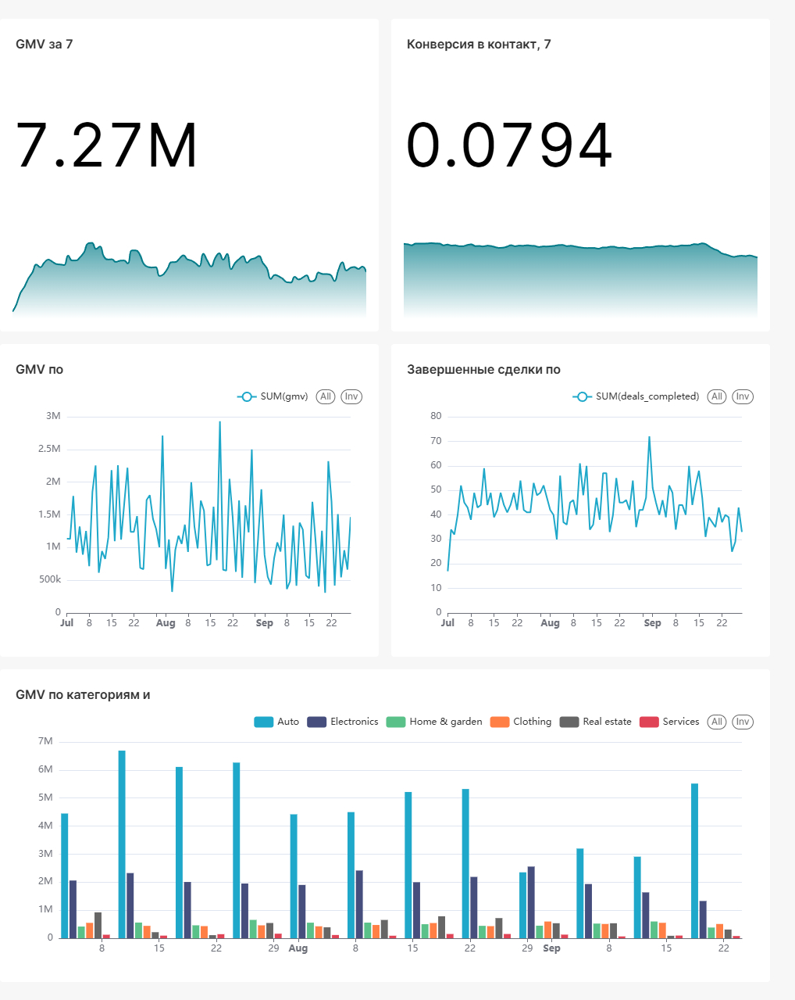

# Разбор инцидента: Падение конверсии в контакт (Electronics)

**Статус:** причина не установлена, требуется проверка продуктовой команды.
**Дата инцидента:** 15 сентября 2026
**Детекция:** автоматическая (z-score = -4.42)

Система мониторинга данных автоматически обнаружила аномалию в метрике `contact_rate` для категории **Electronics**. 
Атрибуция показала, что категория объясняет **100% потерь** контактов. Проверки качества данных (`mart_data_quality`) подтвердили целостность пайплайна, исключив технические сбои загрузки.

## Период анализа

- **Общий объем данных:** 1 июля - 28 сентября 2026 (90 дней синтетических данных).
- **Базовый период (норма):** 18 августа - 14 сентября (28 дней).
- **Период инцидента:** 15 сентября - 28 сентября (14 дней).

*(Первые 14 дней нужны детектору, чтобы накопить историю для базового уровня.).*

## Что случилось (в цифрах)

Среднее в день: последние 14 дней против 28 дней до них.

| Показатель | Изменение |
|---|---|
| Показы | +0,1 % |
| Просмотры | +0,1 % |
| Контакты с продавцом | −14,3 % |
| Конверсия просмотр - контакт | −14,4 % (итого 8,05 %) |
| Завершенные сделки | −17,2 % |
| GMV | −5,7 % |

Трафик не изменился, упала конверсия: проблема не в привлечении, а в том, что меньше людей
связываются с продавцами.

## Хронология и визуализация
### Шаг 1: Обнаружение
Детектор на базе z-score сработал в первый же день инцидента.
- **Где смотреть:** вкладка **Data Quality**, таблица *Обнаруженные аномалии*.
- **Сигнал:** 15 сентября, категория `Electronics`, `contact_rate`, `z-score` = −4,42. Затем 16, 17 и 18 сентября (−3,95; −4,01; −3,09).
- **Данные:** статус загрузки `ok`, потерь строк нет, объем в коридоре нормы.

### Шаг 2: Локализация
Сравнение конверсии по категориям показало, что проблема изолирована.
- **Где смотреть:** вкладка **Conversion Funnel**.
- **Электроника:** конверсия в контакт упала с 11,8 % до 6,65 % (−43,6 %), линия Electronics резко уходит вниз с 15 сентября. Остальные категории в пределах −6…+6 %, то есть в зоне шума.
- **Атрибуция:** Electronics объясняет 100,3 % потерь (около 695 контактов за 14 дней).
- **Платформы и регионы:** падение везде одинаковое (−12…−18 %) и пропорционально трафику, ни одна платформа или регион не выделяются. Причина привязана к категории, а не к устройству или географии.

### Шаг 3: Оценка влияния на бизнес
- **Где смотреть:** вкладка **Executive Overview**.
- **Наблюдение:** общий GMV снизился умеренно (−5,7 %), контакты и завершенные сделки сильнее (−14 % и −17 %). Electronics составляет лишь часть трафика, поэтому общий обрыв не катастрофичен, но локальное падение внутри категории критично.

## Выводы

1. **Где и когда:** Electronics, с 15 сентября, на этапе «просмотр → контакт».
2. **Вероятная причина:** лежит в продукте категории (проблема данных исключена), точную причину предстоит выяснить.
3. **Что проверить:** релизы карточки объявления Electronics, кнопку «Связаться с продавцом», изменения модерации и ценовых правил за 14–15 сентября.
4. **Оценка потерь (расчетная):** около 695 контактов за 14 дней; при средней конверсии категории это порядка 100 сделок и около 1,8 млн ₽ GMV. Это ожидаемые потери, а не наблюдаемое значение.

## Сверка с заложенным сценарием

Данные синтетические, поэтому причина известна заранее: в генераторе с 15 сентября
вероятность контакта в Electronics умножена на 0,55 (−45 %), все остальное не менялось.

| Что заложено | Что нашла система |
|---|---|
| Категория Electronics | Electronics = 100,3 % потерь |
| Падение конверсии на 45 % | −43,6 % |
| Начало 15 сентября | сигнал в первый день |
| Остальные категории, платформы, регионы не затронуты | падение пропорционально трафику |

Система воспроизвела заложенный сценарий. В реальной работе такой сверки нет:
по данным можно определить где и когда, а причину устанавливает продуктовая команда.

## Ограничения

- **Ложные срабатывания:** за 90 дней помечено 11 строк, из них 4 настоящих. Три ложных попали в последние 14 дней (Real estate 19 сентября, Clothing 22 сентября, Electronics `view_rate` 15 сентября): при пороге 3 сигмы и 12 рядах метрик это ожидаемо.
- **Затухание сигнала:** при длинном инциденте скользящий базовый уровень привыкает к падению, и z-score ослабевает (после 18 сентября он ниже порога).
- **Свежие 4 дня** по сделкам неполные: сделки появляются через часы и дни после контакта.
- **GMV шумный:** в нем доминируют редкие крупные сделки, поэтому −5,7 % нельзя целиком приписать инциденту.

## Что улучшить в мониторинге

1. Алерт на |z| > 3 два дня подряд, чтобы убрать единичные ложные срабатывания.
2. Фиксированный эталонный период, чтобы длинные инциденты не «растворялись» в базе.